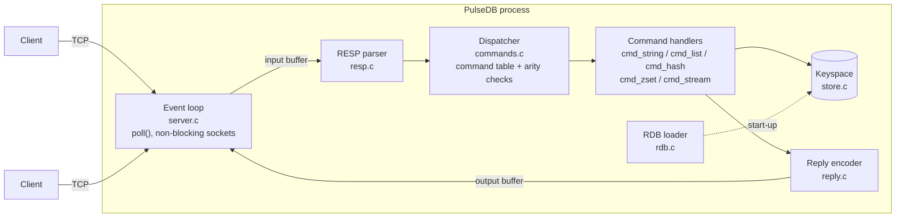

# PulseDB

[](https://github.com/Lancelcode/PulseDB/actions/workflows/ci.yml)


PulseDB is a Redis-compatible in-memory database server written from scratch in C99,
with no third-party libraries. It speaks the Redis wire protocol (RESP), so standard
tools such as `redis-cli` can talk to it. Replies were checked against Redis 7 for the
supported commands; for example, `GEODIST` and `GEOPOS` give identical results.

I built it to understand the layer most backend engineers use every day but rarely
look inside: how a command travels from a socket to a data structure and back, how
keys expire without a background thread, how sorted sets stay sorted, and how one
thread can serve many clients at once.

## Features

| Area         | Commands                                                        |
|--------------|-----------------------------------------------------------------|
| Strings      | `SET` (with `EX`/`PX`), `GET`, `INCR`, `DECR`, `INCRBY`, `DECRBY` |
| Keys         | `DEL`, `EXISTS`, `TYPE`, `TTL`, `PTTL`, `KEYS`                    |
| Lists        | `LPUSH`, `RPUSH`, `LPOP`, `RPOP`, `LLEN`, `LRANGE`, `BLPOP`        |
| Hashes       | `HSET`, `HGET`, `HGETALL`, `HMGET`, `HDEL`, `HLEN`                |
| Sorted sets  | `ZADD`, `ZRANGE [WITHSCORES]`, `ZRANGEBYSCORE`, `ZRANK`, `ZSCORE`, `ZCARD` |
| Streams      | `XADD`, `XRANGE`, `XREAD [COUNT]`                                 |
| Geo          | `GEOADD`, `GEODIST`, `GEOPOS`                                     |
| Transactions | `MULTI`, `EXEC`, `DISCARD`                                        |
| Server       | `PING`, `ECHO`, `CONFIG GET`                                      |

It also supports pipelining, inline commands (so `nc` and `telnet` work), and loading
string keys from a Redis RDB file at start-up.

## Architecture



Each connection has its own input buffer, output buffer and transaction state. The event
loop reads whatever bytes have arrived, parses as many complete requests as the buffer
holds, runs them in order, and writes the replies back when the socket is ready.

| File | Responsibility |
|------|----------------|
| `src/server.c`   | Event loop, connection lifecycle, blocked clients, shutdown |
| `src/resp.c`     | Incremental, bounds-checked RESP parser (requests and replies) |
| `src/commands.c` | Command table, arity checking, `MULTI`/`EXEC`/`DISCARD` |
| `src/cmd_*.c`    | Command implementations grouped by data type |
| `src/store.c`    | Keyspace hash table, lazy expiry, lists, hashes, sorted sets, streams |
| `src/reply.c`    | RESP reply encoding |
| `src/geo.c`      | 52-bit interleaved geohash, haversine distance |
| `src/rdb.c`      | RDB file loader |
| `src/config.c`   | Defaults and command-line options |
| `tools/cli.c`    | `pulsedb-cli` client and REPL |

## Key design decisions

**One thread, no locks.** Every command runs to completion before the next starts, which
makes each command atomic and `MULTI`/`EXEC` simple to get right, just as in Redis. The
network side uses non-blocking sockets and `poll()`, so a slow or idle client never stalls
anyone else. The cost is that one expensive command (such as `KEYS *` on a large keyspace)
delays every client while it runs.

**Lazy expiry.** A key's expiry time is stored alongside it and checked whenever the key is
looked up. Expired keys are removed at that point, so there is no background sweeper thread.
The trade-off is that an expired key nobody reads keeps its memory until it is touched or
deleted.

**Restartable parsing.** The parser takes a byte range and either returns a complete request,
says it needs more bytes, or reports a protocol error. It never reads past the data it was
given and never trusts length headers for allocation, so truncated, split or hostile input
is handled safely. Bulk strings are capped at 64 MB and a client's unparsed input at 256 MB.

**Blocking without blocking.** `BLPOP` on an empty list parks the client inside the event loop,
which retries it every 10 ms until data arrives or the timeout passes. Other clients carry on
being served in the meantime.

**Errors are values.** Store functions return a status (`STORE_OK`, `STORE_WRONG_TYPE`,
`STORE_OVERFLOW`, ...) and handlers turn that into the matching Redis error, so wrong-type
access, integer overflow and invalid stream IDs are all reported rather than corrupting data.

**Data structures.**
- Keyspace: a chained hash table that doubles when it fills up, with each entry caching its
  64-bit hash so lookups rarely need a full string comparison.
- Lists: doubly linked, O(1) push and pop at either end.
- Hashes: a 64-bucket chained hash table per key.
- Sorted sets: an array kept ordered by (score, member) for range queries, plus a hash
  index from member to score. Score lookups are O(1) and ranks O(log n); inserting still
  shifts the array, which is O(n) but a fast `memmove`.
- Streams: an append-only linked list with strictly increasing `ms-seq` IDs.
- Geo: latitude and longitude are each quantised to 26 bits and interleaved into a 52-bit
  integer, stored as a sorted-set score (the same encoding Redis uses).

## Build, run and test

You need a C99 compiler and `make`. It is developed and tested on Linux; other POSIX systems
should work but are untested.

```sh
make                 # builds ./pulsedb
./pulsedb            # listens on 127.0.0.1:6379
./pulsedb --port 7000 --bind 0.0.0.0 --dir /var/lib/pulsedb
```

Then connect with any Redis client:

```sh
redis-cli -p 6379 set greeting hello
redis-cli -p 6379 get greeting
printf 'PING\r\n' | nc -q1 127.0.0.1 6379     # inline commands also work
```

Run the tests:

```sh
make test        # unit tests plus end-to-end tests against a real server process
make sanitize    # the same tests built with AddressSanitizer and UBSan
```

The unit tests cover the parser (including every truncated prefix of a request), the
store, geo encoding and the RDB loader. The end-to-end tests start `./pulsedb` on a free
port and check each command family, transactions, pipelining, `BLPOP` wake-up and timeout,
an idle client not stalling the server, and protocol-error handling. GitHub Actions runs
them with GCC and Clang, and again under the sanitisers, on every push and pull request.

## Command-line client

`make` also builds `pulsedb-cli`, a small client with no dependencies. It works with
PulseDB or any Redis server.

```sh
./pulsedb-cli set greeting "hello world"       # one-shot: run a command and exit
./pulsedb-cli -h 10.0.0.5 -p 7000 get greeting
./pulsedb-cli                                  # interactive prompt
127.0.0.1:6379> rpush jobs "resize image" email
(integer) 2
127.0.0.1:6379> lrange jobs 0 -1
1) "resize image"
2) "email"
127.0.0.1:6379> quit
```

Words are separated by spaces. Use `"double"` or `'single'` quotes for values containing
spaces; inside double quotes, `\n`, `\t`, `\"` and `\\` are escapes. Replies are printed in
the same style as `redis-cli`. When input is piped in, the prompt is omitted, so scripts
can send a batch of commands: `printf 'incr hits\nget hits\n' | ./pulsedb-cli`.

## Docker

```sh
docker build -t pulsedb .
docker run -d --name pulsedb -p 6379:6379 -v pulsedb-data:/data pulsedb
docker exec -it pulsedb pulsedb-cli          # client inside the container
./pulsedb-cli -p 6379 ping                   # or from the host
```

The image is a two-stage build: the first stage compiles PulseDB and runs the full test
suite, and the second ships only the two binaries on `debian:bookworm-slim`, running as a
non-root user. Inside the container the server binds to `0.0.0.0` and reads its RDB file
from `/data`. Extra arguments after the image name are passed to `pulsedb`, for example
`docker run pulsedb --port 7000`. If Docker Hub is unavailable, pass a mirror with
`--build-arg BASE_IMAGE=<registry>/debian:bookworm-slim`.

## Examples

The [`examples/`](examples) folder has three small programs:

| Example | Shows |
|---------|-------|
| [`leaderboard.sh`](examples/leaderboard.sh) | A game leaderboard with `ZADD`, `ZRANGE ... WITHSCORES`, `ZRANGEBYSCORE` and `ZRANK` |
| [`job_queue.sh`](examples/job_queue.sh) | A worker blocked in `BLPOP` woken by a producer, plus a `MULTI`/`EXEC` counter update |
| [`embedded_geo.c`](examples/embedded_geo.c) | Using the store as an in-process C library: geohash encoding and distances, no server |

```sh
make examples
./pulsedb &                       # the shell examples need a running server
examples/leaderboard.sh
examples/job_queue.sh
./build/embedded_geo
```

The shell scripts use `./pulsedb-cli` on port 6379; set `PULSEDB_CLI` or `PULSEDB_PORT`
to change that.

## Benchmarks

```sh
make bench                      # full run (200k operations per test)
make bench BENCH_ARGS=--quick   # quick run (20k), used in CI
```

The `store` rows call the data structures directly. The `network` rows go through a real
server process over loopback TCP, so they include parsing, dispatch and system calls.
"Pipeline 32" sends 32 commands before waiting for the replies.

Measured on a 4-vCPU Intel Xeon VM at 2.10 GHz with 15 GiB RAM, running Ubuntu 24.04 and
GCC 13.3 at `-O2`. Each figure is the median of three runs; individual runs varied by up to
about 20%, so treat small differences as noise.

| Layer   | Operation                    | Before (ops/s) | After (ops/s) | Speed-up |
|---------|------------------------------|---------------:|--------------:|---------:|
| store   | SET (insert 200k new keys)   |        363,000 |     4,050,000 |    11×   |
| store   | GET (random point reads)     |        144,000 |     4,440,000 |    31×   |
| store   | HSET (1k hashes)             |      3,590,000 |     5,270,000 |   1.5×   |
| store   | List scan, first 100 items   |      5,930,000 |     6,820,000 | (noise)  |
| store   | ZADD (one set, 20k members)  |         37,600 |       594,000 |    16×   |
| store   | ZSCORE (random members)      |         33,700 |     9,550,000 |   280×   |
| store   | XADD (auto IDs)              |      3,160,000 |     3,920,000 | (noise)  |
| network | SET, no pipelining           |         26,500 |        27,000 |   1.0×   |
| network | GET, no pipelining           |         25,900 |        26,800 |   1.0×   |
| network | SET, pipeline 32             |        174,000 |       576,000 |   3.3×   |
| network | GET, pipeline 32             |        107,000 |       521,000 |   4.9×   |

"Before" is the code after the correctness fixes but before any optimisation; "after" is
the current code.

### What was optimised, and why

I profiled the benchmarks with Valgrind's `callgrind` (the store benchmark directly, and the
server process while the network benchmark ran against it) and fixed the three hottest
paths:

1. **Keyspace hash table.** `strcmp` was 41% of all instructions in the store benchmark,
   mostly from walking bucket chains. The table had a fixed 1024 buckets, so at 200k keys
   each chain held about 200 entries. It now doubles whenever the number of keys exceeds
   the number of buckets, and each entry caches its 64-bit FNV-1a hash, so a chain walk
   compares integers and only calls `strcmp` on a likely match.
2. **Sorted-set member lookup.** `store_zset_add` and `store_zset_score` together took 56%
   of the store benchmark, because every lookup by member name scanned the whole array.
   Each sorted set now also keeps a hash index from member to score: `ZSCORE` is O(1), and
   `ZRANK` and `ZADD` find the member's slot by binary search on (score, member).
3. **Command dispatch.** In the server profile, `strcasecmp` was 8% of instructions, because
   each request scanned the command table linearly and then made three more comparisons
   for `MULTI`/`EXEC`/`DISCARD`. Commands are now found through a small hash table keyed
   on the lower-cased name.

Unpipelined network throughput did not change. Each request there waits for a full
loopback round trip, so the cost is in system calls and scheduling rather than in
PulseDB's code. Pipelining is what exposes the server's own CPU cost, which is where the
3–5× gain shows.

The next hot spot in the server profile is memory allocation: each request allocates a
parsed array and a copy of every argument (`malloc` and `free` were about 25% of
instructions). Parsing arguments in place in the input buffer would remove most of that.

## Limitations

These are deliberate scope limits rather than bugs:

- No persistence on write: the RDB file is read at start-up but never saved. Only string
  values are loaded; files containing other types are rejected rather than half-loaded.
- Keys and values are C strings, so arguments containing NUL bytes are rejected.
- No authentication, replication, pub/sub, `WATCH` or `EXPIRE`. The server binds to
  `127.0.0.1` by default for that reason.
- `XREAD` does not support `BLOCK`.
- IPv4 only.

## Roadmap

- Zero-copy request parsing to cut per-request allocation
- A skip list for sorted sets, so inserts are O(log n) too
- Incremental rehashing, so growing a very large keyspace never pauses the server
- `SAVE`/`BGSAVE` and loading of all RDB value types
- `EXPIRE`, `WATCH` and active expiry

---

Built by [Djiby Sow Rebollo](https://github.com/Lancelcode), Edinburgh, Scotland.
