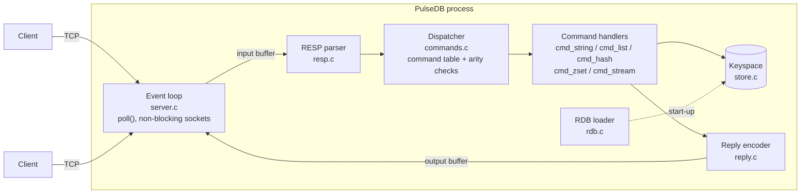

# PulseDB

[](https://github.com/Lancelcode/PulseDB/actions/workflows/ci.yml)


PulseDB is a Redis-compatible in-memory database server written from scratch in C99,
with no third-party libraries. It speaks the Redis wire protocol (RESP), so standard
tools such as `redis-cli` can talk to it. Replies were checked against Redis 7 for the
supported commands; for example, `GEODIST` and `GEOPOS` give identical results.

I built it to understand the layer most backend engineers use every day but rarely
look inside: how a command travels from a socket to a data structure and back, how
keys expire without a background thread, how sorted sets stay sorted, and how one
thread can serve many clients at once.

## Features

| Area         | Commands                                                        |
|--------------|-----------------------------------------------------------------|
| Strings      | `SET` (with `EX`/`PX`), `GET`, `INCR`, `DECR`, `INCRBY`, `DECRBY` |
| Keys         | `DEL`, `EXISTS`, `TYPE`, `TTL`, `PTTL`, `KEYS`                    |
| Lists        | `LPUSH`, `RPUSH`, `LPOP`, `RPOP`, `LLEN`, `LRANGE`, `BLPOP`        |
| Hashes       | `HSET`, `HGET`, `HGETALL`, `HMGET`, `HDEL`, `HLEN`                |
| Sorted sets  | `ZADD`, `ZRANGE [WITHSCORES]`, `ZRANGEBYSCORE`, `ZRANK`, `ZSCORE`, `ZCARD` |
| Streams      | `XADD`, `XRANGE`, `XREAD [COUNT]`                                 |
| Geo          | `GEOADD`, `GEODIST`, `GEOPOS`                                     |
| Transactions | `MULTI`, `EXEC`, `DISCARD`                                        |
| Server       | `PING`, `ECHO`, `CONFIG GET`                                      |

It also supports pipelining, inline commands (so `nc` and `telnet` work), and loading
string keys from a Redis RDB file at start-up.

## Architecture



Each connection has its own input buffer, output buffer and transaction state. The event
loop reads whatever bytes have arrived, parses as many complete requests as the buffer
holds, runs them in order, and writes the replies back when the socket is ready.

| File | Responsibility |
|------|----------------|
| `src/server.c`   | Event loop, connection lifecycle, blocked clients, shutdown |
| `src/resp.c`     | Incremental, bounds-checked RESP parser (requests and replies) |
| `src/commands.c` | Command table, arity checking, `MULTI`/`EXEC`/`DISCARD` |
| `src/cmd_*.c`    | Command implementations grouped by data type |
| `src/store.c`    | Keyspace hash table, lazy expiry, lists, hashes, sorted sets, streams |
| `src/reply.c`    | RESP reply encoding |
| `src/geo.c`      | 52-bit interleaved geohash, haversine distance |
| `src/rdb.c`      | RDB file loader |
| `src/config.c`   | Defaults and command-line options |

## Key design decisions

**One thread, no locks.** Every command runs to completion before the next starts, which
makes each command atomic and `MULTI`/`EXEC` simple to get right, just as in Redis. The
network side uses non-blocking sockets and `poll()`, so a slow or idle client never stalls
anyone else. The cost is that one expensive command (such as `KEYS *` on a large keyspace)
delays every client while it runs.

**Lazy expiry.** A key's expiry time is stored alongside it and checked whenever the key is
looked up. Expired keys are removed at that point, so there is no background sweeper thread.
The trade-off is that an expired key nobody reads keeps its memory until it is touched or
deleted.

**Restartable parsing.** The parser takes a byte range and either returns a complete request,
says it needs more bytes, or reports a protocol error. It never reads past the data it was
given and never trusts length headers for allocation, so truncated, split or hostile input
is handled safely. Bulk strings are capped at 64 MB and a client's unparsed input at 256 MB.

**Blocking without blocking.** `BLPOP` on an empty list parks the client inside the event loop,
which retries it every 10 ms until data arrives or the timeout passes. Other clients carry on
being served in the meantime.

**Errors are values.** Store functions return a status (`STORE_OK`, `STORE_WRONG_TYPE`,
`STORE_OVERFLOW`, ...) and handlers turn that into the matching Redis error, so wrong-type
access, integer overflow and invalid stream IDs are all reported rather than corrupting data.

**Data structures.**
- Keyspace: a chained hash table (djb2) with 1024 buckets.
- Lists: doubly linked, O(1) push and pop at either end.
- Hashes: a 64-bucket chained hash table per key.
- Sorted sets: an array kept ordered by (score, member). Insertion uses binary search;
  looking up a member by name is a linear scan.
- Streams: an append-only linked list with strictly increasing `ms-seq` IDs.
- Geo: latitude and longitude are each quantised to 26 bits and interleaved into a 52-bit
  integer, stored as a sorted-set score (the same encoding Redis uses).

## Build, run and test

You need a C99 compiler and `make`. It is developed and tested on Linux; other POSIX systems
should work but are untested.

```sh
make                 # builds ./pulsedb
./pulsedb            # listens on 127.0.0.1:6379
./pulsedb --port 7000 --bind 0.0.0.0 --dir /var/lib/pulsedb
```

Then connect with any Redis client:

```sh
redis-cli -p 6379 set greeting hello
redis-cli -p 6379 get greeting
printf 'PING\r\n' | nc -q1 127.0.0.1 6379     # inline commands also work
```

Run the tests:

```sh
make test        # unit tests plus end-to-end tests against a real server process
make sanitize    # the same tests built with AddressSanitizer and UBSan
```

The unit tests cover the parser (including every truncated prefix of a request), the
store, geo encoding and the RDB loader. The end-to-end tests start `./pulsedb` on a free
port and check each command family, transactions, pipelining, `BLPOP` wake-up and timeout,
an idle client not stalling the server, and protocol-error handling. GitHub Actions runs
them with GCC and Clang, and again under the sanitisers, on every push and pull request.

## Benchmarks

```sh
make bench                      # full run (200k operations per test)
make bench BENCH_ARGS=--quick   # quick run (20k), used in CI
```

The `store` rows call the data structures directly. The `network` rows go through a real
server process over loopback TCP, so they include parsing, dispatch and system calls.
"Pipeline 32" sends 32 commands before waiting for the replies.

Measured on a 4-vCPU Intel Xeon VM at 2.10 GHz with 15 GiB RAM, running Ubuntu 24.04 and
GCC 13.3 at `-O2`. Each figure is from a single run. Repeat runs varied by up to about 20%, and the sorted-set
rows by more, so treat the numbers as orders of magnitude rather than precise values.

| Layer   | Operation                    | Ops/sec   | ns/op  |
|---------|------------------------------|----------:|-------:|
| store   | SET (insert 200k new keys)   |   430,000 |  2,300 |
| store   | GET (random point reads)     |   150,000 |  6,700 |
| store   | HSET (1k hashes)             | 3,360,000 |    300 |
| store   | List scan, first 100 items   | 6,180,000 |    160 |
| store   | ZADD (one set, 20k members)  |    34,000 | 29,000 |
| store   | ZSCORE (random members)      |    35,000 | 29,000 |
| store   | XADD (auto IDs)              | 3,440,000 |    290 |
| network | SET, no pipelining           |    28,000 | 36,000 |
| network | GET, no pipelining           |    27,000 | 36,000 |
| network | SET, pipeline 32             |   187,000 |  5,400 |
| network | GET, pipeline 32             |   109,000 |  9,200 |

Two weak spots stand out. Point reads slow down as the keyspace grows because the table
has a fixed 1024 buckets, so 200k keys means chains of about 200 entries. Sorted-set
operations are linear in the size of the set because members are found by scanning.

## Limitations

These are deliberate scope limits rather than bugs:

- No persistence on write: the RDB file is read at start-up but never saved. Only string
  values are loaded; files containing other types are rejected rather than half-loaded.
- Keys and values are C strings, so arguments containing NUL bytes are rejected.
- No authentication, replication, pub/sub, `WATCH` or `EXPIRE`. The server binds to
  `127.0.0.1` by default for that reason.
- `XREAD` does not support `BLOCK`.
- IPv4 only.

## Roadmap

- Resizable keyspace hash table
- Sorted sets with O(log n) member lookup
- `SAVE`/`BGSAVE` and loading of all RDB value types
- `EXPIRE`, `WATCH` and active expiry

---

Built by [Djiby Sow Rebollo](https://github.com/Lancelcode), Edinburgh, Scotland.
